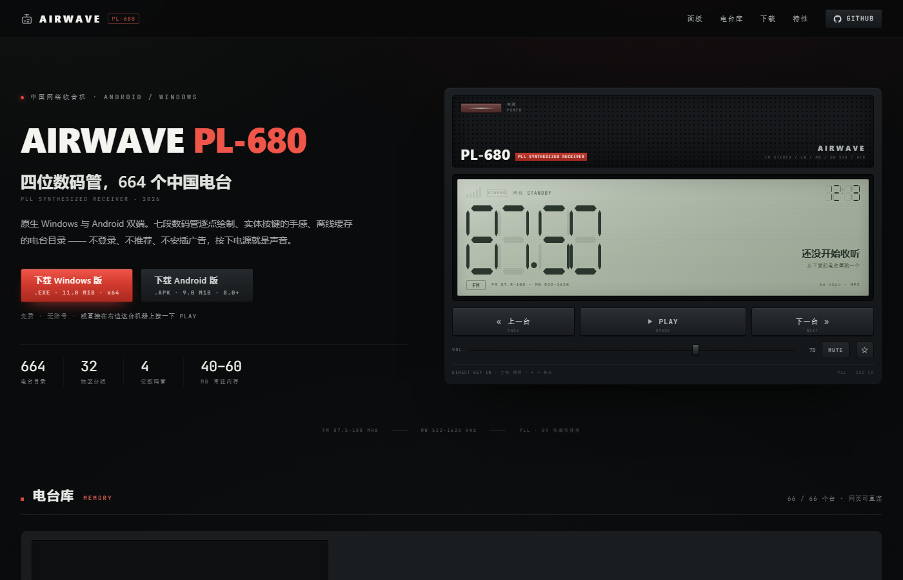
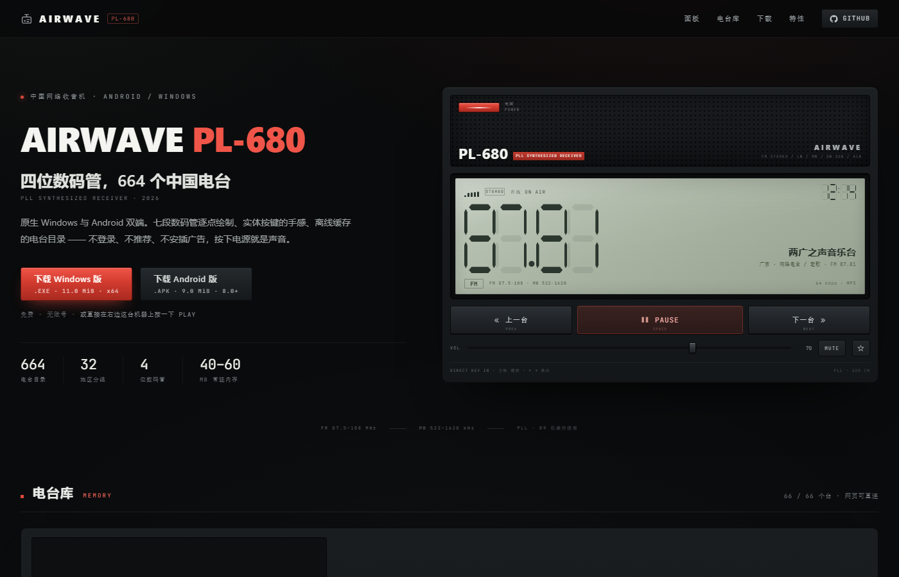

# AIRWAVE PL-680

一台按 PL-680 短波收音机外观做的网络电台播放器，Windows 桌面版 + Android 版 + 网页版三端同源。
四位数码管逐段绘制，实体按键手感，离线缓存的中国电台目录，不做推荐、不插播广告，按下电源就是声音。



## 三端

| 端 | 技术栈 | 体积 | 内存 |
| --- | --- | --- | --- |
| Windows | Rust + Slint 1.18，symphonia + cpal 解码输出 | 单文件 11.0 MiB | 空载 40–60 MB |
| Android | Kotlin + Jetpack Compose + Media3，前台服务播放 | APK 9.0 MiB | 系统托管 |
| Web | 原生 HTML/CSS/JS，无框架、无构建 | 140 KB | 浏览器标签页 |

网页版：<https://airwave.800820882.xyz/>（Cloudflare Pages + 自定义域名）

## 下载

| 文件 | 大小 | 地址 |
| --- | --- | --- |
| Windows 免安装 exe | 11.0 MiB | <https://dl.800820882.xyz/AIRWAVE-PL680-Setup-1.0.exe> |
| Android APK | 9.0 MiB | <https://dl.800820882.xyz/AIRWAVE-PL680-1.0.apk> |

两个安装包都放在 Cloudflare R2 桶 `airwave-pl680` 里，通过自定义域名 `dl.800820882.xyz` 分发，校验和：

```
53023f53505c65211b40a667d3a9ff952a9820acbb872c4d6e1427072f02c496  AIRWAVE-PL680-Setup-1.0.exe
ccc9ad252d1b71b26e515f4aad03ff5c064db688decce2de2fc70f63f72bccae  AIRWAVE-PL680-1.0.apk
```

## 声音与显示

- **频率不是随便编的**：同一个哈希公式（`h = (h*31 + charCode) % 99991`）在 Kotlin、Rust、JS 三端各实现一遍，同一个电台在三端显示的频率完全一致。
- FM 显示 4 位、小数点固定在第 2 位与第 3 位之间；MW 显示 4 位、无小数点，5900–9900 kHz 取整到 5。
- LCD 上的小数点在 FM 模式下才出现，切到 MW 后该格熄灭——这一点和真实收音机的数码管一致。



## 目录

- 桌面/安卓内置 664 个中国电台（按省份分组，含港澳台），首次启动写入本地缓存，断网也能翻列表。
- 网页版只收录 66 个实测可直连的 MP3 流（逐个 curl 探测过 200 + `audio/mpeg`），所以网页上不存在点了没反应的台。
- 数据来源：[radio-browser.info](https://www.radio-browser.info/)。

## 构建

### Windows（Rust 1.83+）

```bash
cd native
cargo build --release
# 产物 native/target/release/airwave-native.exe
```

### Android（JDK 17 + Gradle 8.10.2 + Android SDK 35）

```bash
cd android
# 先写 local.properties 指向本机 SDK：sdk.dir=...
gradle assembleRelease
# 产物 app/build/outputs/apk/release/app-release.apk
```

仓库里的 release 构建沿用 debug 签名，装在自己的手机上没问题；要上架或长期分发，请在
`app/build.gradle.kts` 里换成自己的 keystore。

### Web

纯静态，任何静态服务器都行：

```bash
cd web
python -m http.server 8099
# 打开 http://127.0.0.1:8099/
```

重新部署到 Cloudflare Pages（需要先 `wrangler login`）：

```bash
wrangler pages deploy web --project-name airwave-pl680 --branch main
```

Pages 项目 `airwave-pl680` 绑了自定义域名 `airwave.800820882.xyz`；R2 桶绑了 `dl.800820882.xyz`。
桶的 r2.dev 测试域名是关闭的（带限流，也不希望出现第二个下载入口）；要临时开回来：

```bash
wrangler r2 bucket dev-url enable airwave-pl680
```

安装包重新上传到 R2：

```bash
wrangler r2 object put airwave-pl680/AIRWAVE-PL680-Setup-1.0.exe --file AIRWAVE-PL680-Setup-1.0.exe --content-type application/vnd.microsoft.portable-executable --remote
wrangler r2 object put airwave-pl680/AIRWAVE-PL680-1.0.apk --file AIRWAVE-PL680-1.0.apk --content-type application/vnd.android.package-archive --remote
```

## 目录结构

```
web/                静态主页（播放器 + 电台库 + 下载）
  index.html
  assets/style.css  设计令牌与七段数字几何
  assets/app.js     播放逻辑、筛选、键盘快捷键
  assets/stations.json  66 个实测可直连电台
native/             Rust + Slint 桌面端
  src/audio.rs      解码与输出
  src/main.rs       目录、状态、开机自启
  ui/app.slint      整台机器的界面
android/            Compose 安卓端
  app/src/main/java/...
docs/               截图
```

## 快捷键（网页版）

`空格` 播放/暂停　`←` `→` 换台　`/` 搜索　`m` 静音　`f` 收藏

## 许可

代码 MIT。电台目录数据来自 radio-browser.info，音频流版权归各电台所有，本项目只做索引。
